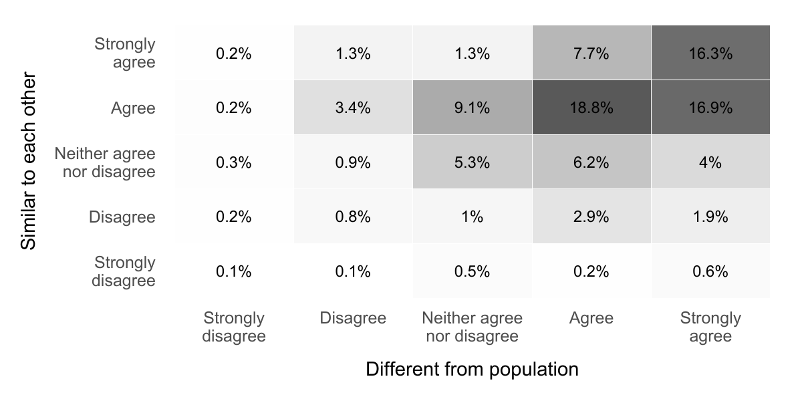
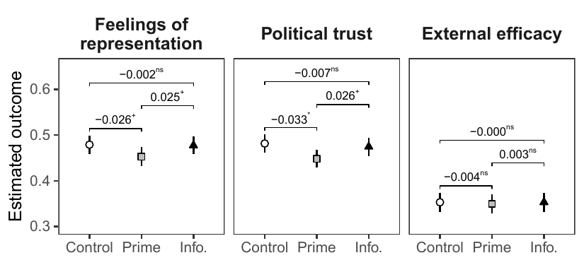
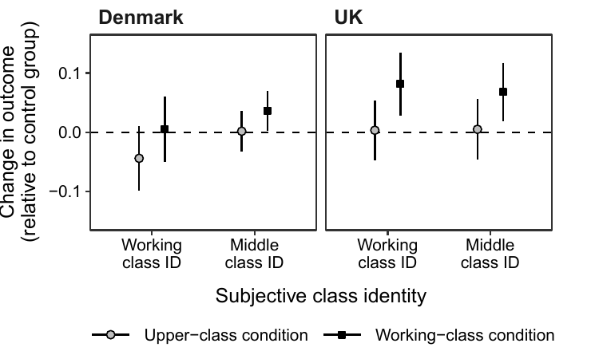

```{r}
#| echo: false
#| include: false
#| eval: false   # <-- add this line

#install.packages("pdftools")
library(pdftools)
#pdf_convert("research_outputs/pol_class_paper/paper1.pdf", format = "png", dpi = 150, filenames = "research_outputs/pol_class_paper/paper1b.png")
pdf_convert("research_outputs/pol_class_paper/paper1a.pdf", format = "png", dpi = 150, filenames = "research_outputs/pol_class_paper/paper1a.png")

```
## Publications

::::: {.paper}

::: {.paper-title}
The Political Class in Citizens' Minds: Mapping Public Perceptions of Politicians 
:::

::: {.paper-meta}
*European Journal of Political Research*, 1-18 (2026)
:::

::: {.paper-tabs}
::: {.paper-tab data-title="link" data-href="https://doi.org/10.1017/S1475676526101777"} 
:::

::: {.paper-tab data-title="appendix" data-href="/research_outputs/pol_class_paper/online_appendix_political_class_FINAL.pdf"} 
:::

::: {.paper-tab data-title="replication" data-href="https://dataverse.harvard.edu/dataset.xhtml?persistentId=doi:10.7910/DVN/DYZ1P7"} 
:::
:::


::: {.paper-abstract}
Politicians are often portrayed as a socially distinct and internally homogeneous elite -- a narrative central to populist rhetoric and scholarly debates on political discontent. Yet we know little about how voters mentally represent politicians. Using survey data from Denmark (N = 1,302), combining free association tasks, open-ended descriptions, and closed-ended items, I demonstrate that most citizens view politicians as both internally homogeneous and socially distinct from the general population. These perceptions correlate with negative characterisations and significantly lower political trust, external efficacy, and democratic satisfaction. Crucially, perceived social distinctiveness matters more than perceived homogeneity: citizens who view politicians as different from ordinary people show substantially diminished political support, regardless of whether they see politicians as similar to one another. By shifting the analytical focus to citizens’ mental representations, this study highlights the importance of not only who politicians are but also how they are imagined by the public.
:::

```{=html}
<figure class="paper-figure">
  
</figure>
```
:::::

## Working Papers

```{r}
#| echo: false
#| include: false
#install.packages("pdftools")
library(pdftools)

pdf_convert("research_outputs/professionalisation_paper/plot2.pdf", format = "png", dpi = 150, filenames = "research_outputs/professionalisation_paper/plot2.png")


```

::::: {.paper}
::: {.paper-title}
Too Professional to Represent? Perceptions of Politicians' Occupational Experience and Political Support [(Under review)]{.paper-status}
:::

::: {.paper-meta}
*Available upon request*
:::

::: {.paper-tabs}
::: {.paper-tab data-title="pre-registration" data-href="/research_outputs/professionalisation_paper/prereg.pdf"} 
:::
:::

::: {.paper-abstract}
A common concern in contemporary politics is that politicians are increasingly detached from the population. Central to this critique is the claim that politicians lack non-political experience. Yet, little is known about citizens' perceptions of politicians' occupational backgrounds or how these perceptions affect political support. Using an original survey from Denmark (N = 1,712), this paper shows that citizens generally perceive MPs as lacking work experience outside politics. A pre-registered experiment further demonstrates that even subtle priming of these considerations reduces political support, whereas receiving new information does not produce a corresponding increase. Finally, analysis of open-ended responses shows that respondents who perceive MPs as lacking experience are more likely to question the information they receive, suggesting that perceptions of politicians -- and the consequences thereof -- may be rooted more in citizens’ feelings and culturally available narratives than in objective reality.
:::

```{=html}
<figure class="paper-figure">
  
</figure>
```

:::::

::::: {.paper}
```{r}
#| echo: false
#| include: false
#install.packages("pdftools")
library(pdftools)

pdf_convert("research_outputs/class_representation/marginal_effect_cond.pdf", format = "png", dpi = 150, filenames = "research_outputs/class_representation/plot1.png")


```
::: {.paper-title}
Class Representation and Feeling Represented: Experimental Evidence from Denmark and the UK [(Under review)]{.paper-status}
:::
::: {.paper-author}
(with Geoffrey Evans)
:::
::: {.paper-meta}
*Available upon request*
:::
::: {.paper-abstract}
When do changes in the class composition of parliament influence how citizens relate to politics? We address this question using a vignette experiment fielded in Britain and Denmark -- two countries that vary considerably in working-class representation and the salience of class identity. We find that increased upper-class representation does not move feelings of representation in either country, suggesting citizens already perceive parliament as an elite domain. However, consistent with a ‘sociotropic’ model of representation, increased working-class representation boosts Britons’ sense of being represented across the social classes. In Denmark, in contrast, despite respondents clearly responding to the manipula-tion, increased working-class representation has only small and marginally significant effects. Together, the findings indicate that increased working-class representation carries generalised rather than class-specific benefits, but that the effects vary across contexts. The findings advance our understanding of when and for whom class representation is consequential.
:::

```{=html}
<figure class="paper-figure">
  
</figure>
```

:::::

## Work in Progress

::::: {.in-progess-paper}
::: {.in-progess-paper-title}
How ’Who They Are’ Shapes Evaluations of ’What They Do’
:::
:::::


